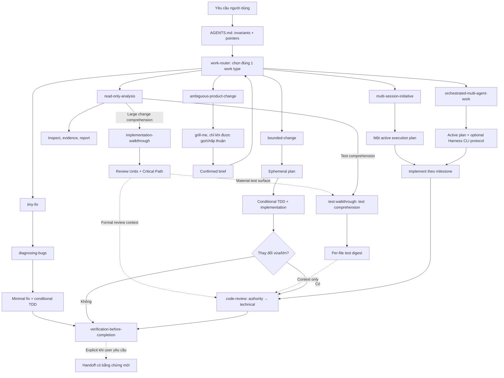

# Repository Harness — Luồng Làm Việc Hiện Tại

> **Explanatory guide only.** Tài liệu này hỗ trợ người đọc hiểu flow và không
> phải workflow authority. Agent không cần đọc mặc định.
>
> Khi có xung đột, dùng `AGENTS.md`, `docs/WORKFLOW.md`, accepted decisions và
> định nghĩa skill liên quan trước; tài liệu này chỉ giải thích các nguồn đó.

Thứ tự ưu tiên để tham khảo là:

1. yêu cầu trực tiếp hiện tại của người dùng;
2. [`AGENTS.md`](../AGENTS.md);
3. [`docs/WORKFLOW.md`](WORKFLOW.md);
4. các product, design, architecture, decision và contract đã được chấp nhận;
5. tài liệu này.

## 1. Mô hình tổng thể

Harness hiện tại có ba lớp tách biệt:

1. **Workflow Git-native mặc định** — dùng repository, tài liệu, code, test,
   runtime evidence và tối đa một execution plan cho mỗi task làm system of
   record.
2. **Bộ skill điều phối** — phân loại task, hỗ trợ chẩn đoán, TDD, review và
   kiểm chứng; skill không tạo một authority hoặc task system thứ hai.
3. **SQLite/CLI compatibility control plane** — chỉ dùng khi người dùng yêu
   cầu rõ, khi bảo trì chính bề mặt compatibility, hoặc khi một external
   orchestrator có contract yêu cầu nó.

Luồng mặc định:



## 2. Cổng vào bắt buộc

Trước khi thay đổi repository state:

1. Đọc `AGENTS.md` áp dụng cho thư mục đang làm việc.
2. Đọc `docs/WORKFLOW.md` và chỉ những nguồn liên quan trực tiếp.
3. Dùng `work-router` để chọn đúng một work type.
4. Với task không tầm thường, thông báo ngắn route đã chọn. Tiny fix hoặc
   read-only rõ ràng route im lặng; luôn thông báo nếu phải reclassify để mở
   rộng workflow.
5. Chỉ sau đó mới chạy downstream skill hoặc thay đổi file/state.

Downstream skill chỉ tinh chỉnh route đã chọn. Nó không được tự mở rộng scope,
tạo plan, story, database hoặc orchestration. Một yêu cầu read-only vẫn phải
read-only kể cả khi phát hiện bug.

### 2.1 Cách viết prompt hiện tại

Prompt không cần gọi tất cả skill bằng tay. Hãy mô tả outcome và ràng buộc;
`AGENTS.md` + `work-router` sẽ chọn route. Với task không tầm thường, nên có
đủ các khối sau:

```text
Mục tiêu: <observable outcome>
Context: <repo/path, behavior hiện tại, input hoặc lỗi cụ thể>
Authority: <product/design/decision/contract cần tuân theo>
Scope: <in scope> | Out of scope: <không làm>
Constraints: <read-only, compatibility, permission, không tạo CLI state...>
Validation: <test/command/runtime proof mong muốn>
Done khi: <acceptance criteria kiểm chứng được>
```

Các prompt mẫu dưới đây là điểm bắt đầu; chúng không thay thế authority trong
repository và không thể biến draft, mockup hoặc active plan thành accepted
authority.

#### Read-only analysis

```text
Hãy kiểm tra vì sao focused test này thất bại: <test/error/input>.
Chỉ chẩn đoán, chưa sửa file hoặc Harness state.
Đọc authority và code liên quan, reproduce bằng command mới, phân biệt
symptom/trigger/root cause, rồi báo evidence, unknowns và limitation.
```

#### Test comprehension

```text
Giải thích các file test trong thay đổi này.
Đọc source production liên quan cùng setup/action/assertion và mock behavior.
Trả về digest theo từng file gồm mục đích, symbol được gọi, hành vi được bảo
vệ, chưa chứng minh, Direct/Partial/Superficial evidence, mức ưu tiên đọc và
một kết luận; không đưa ra overall test confidence.
Không tạo test matrix, Mermaid, severity, approval hoặc formal finding.
Nếu tôi hỏi test đã đủ chưa, chuyển sang code-review.
```

#### Large-change comprehension

```text
Giải thích cách review change lớn này.
Chạy BASELINE, MAP, TRACE, PROBE và HANDOFF.
Gom file theo Review Unit, chọn Critical Path, nêu Risk Probe và Invariant,
phân loại evidence fresh/stale/unavailable, rồi đề xuất review order.
Không tạo finding, không approve, không tự chia hoặc commit git.
Nếu test surface lớn, handoff sang test-walkthrough; formal judgement thuộc
code-review.
```

#### Tiny fix

```text
Hãy sửa bug <symptom> trong <path/module>.
Giữ scope ở behavior này; không tạo active plan hoặc Harness CLI story.
Reproduce trước, xác định root cause, thêm regression test nếu có seam giá trị,
sửa tối thiểu, rồi chạy lại reproduction và validation liên quan.
Chỉ báo fixed khi có fresh evidence và ghi rõ bề mặt chưa test.
```

#### Bounded change

```text
Implement <observable feature/flow> trong một phiên.
Authority: <docs/product/... hoặc contract cụ thể>.
In scope: <...>. Out of scope: <...>.
Khám phá minor implementation details từ repository; nếu còn nhiều product
outcome materially khác nhau thì dừng để hỏi, không tự chọn policy.
Dùng TDD khi có automated seam, review nếu change vừa/lớn, và verify bằng
<commands/acceptance checks>.
```

#### Ambiguous product change

```text
Tôi muốn xây <feature>, nhưng chưa chốt <UX/scope/permission/acceptance
decision>.
Hãy dùng $grill-me, hỏi từng câu một và đưa recommendation ngắn cho mỗi câu.
Chưa viết code, chưa tạo plan/story và chưa ghi tài liệu nếu tôi chưa cho phép.
Kết thúc bằng confirmed Change Brief rồi trả control về workflow bình thường.
```

#### Multi-session initiative

```text
Đây là initiative nhiều phiên: <outcome>.
Milestones: <M1>, <M2>, <M3>. Dependencies/recovery: <...>.
Tạo hoặc resume đúng một docs/plans/active/<slug>.md, ghi authority, scope,
risks, progress và validation. Implement theo milestone; review against
authority và verify từng acceptance criterion trước khi move plan sang
docs/plans/completed/.
```

#### Orchestrated multi-agent work

```text
Đây là task cần orchestrator vì có <dependencies/locking/retry/runnable
selection/lifecycle>.
Chỉ dùng Harness CLI nếu <external orchestrator/contract> thực sự yêu cầu.
Discovery trước mutation: query contract --json; kiểm tra protocol, database
state và capabilities. Dùng work-graph cho một scheduling read, guarded
mutations cho state changes, và rediscover sau timeout/conflict.
Không coi story/trace/score là behavior proof; completion vẫn cần fresh
verification.
```

#### Khi muốn báo cáo/review, không muốn sửa

```text
Hãy review <patch/path> theo accepted authority hiện tại.
Đây là read-only: không format, không sửa, không stage.
Trả findings theo Severity/Claim/Authority and evidence/File and location/
Impact/Required correction/Validation to rerun; tách riêng Decision required
và ghi rõ những gì chưa được test.
```

Prompt càng rõ về outcome, scope và proof thì route càng ổn định. Nhưng câu
“hãy dùng skill X” không tự cấp thêm quyền: `AGENTS.md`, authority precedence
và completion gate vẫn áp dụng trước mọi prompt detail.

## 3. Authority trước implementation

Khi các nguồn mâu thuẫn, dùng thứ tự:

1. yêu cầu trực tiếp hiện tại của người dùng;
2. product documentation đã được chấp nhận;
3. design documentation đã được chấp nhận;
4. architecture và accepted decision records;
5. accepted API, security và permission contracts;
6. active execution plan với vai trò hướng dẫn thực thi;
7. behavioral tests;
8. code hiện tại như observed behavior, không phải product policy.

Một tài liệu chỉ là accepted authority khi có ít nhất một điều kiện:

- người dùng hiện tại đã phê duyệt rõ;
- repository workflow chỉ định nó là authoritative;
- một accepted decision record đã tiếp nhận nó.

Draft, proposal, generated document và mockup không tự trở thành authority chỉ
vì tồn tại. Active plan được phép dẫn authority đã được chấp nhận, nhưng không
được ban authority cho draft hoặc ghi đè API/security/permission contract. Nếu
plan ghi lại approval, approval đó phải đến từ người dùng hoặc một authority
source đã được công nhận.

Nếu vẫn còn nhiều lựa chọn tạo ra user outcome, permission policy, UX flow hoặc
acceptance contract khác nhau, dừng trước khi sửa code và chuyển sang
`ambiguous-product-change`.

## 4. Ba câu hỏi xác định work shape

### 4.1 Có cần durable memory không?

- Không: dùng ephemeral plan trong phiên hiện tại.
- Có: tạo hoặc tiếp tục đúng một file trong `docs/plans/active/`.

Durable plan cần thiết khi công việc:

- có khả năng kéo dài qua nhiều phiên;
- phối hợp nhiều contributor/agent;
- có dependency hoặc thứ tự quan trọng;
- cần recovery/rollback rõ;
- không thể resume an toàn chỉ từ diff cuối.

### 4.2 Có cần human judgment không?

Dừng và xin quyết định nhỏ nhất cần thiết khi thiếu authority cho product
intent, security, compatibility, permission, hard-to-recover action hoặc mức
validation cần thiết. Configurable default không tự tạo product authority.

### 4.3 Điều gì chứng minh behavior?

Chọn proof theo behavior bị ảnh hưởng:

| Behavior | Proof phù hợp |
| --- | --- |
| Rule hoặc mapper cục bộ | Focused unit/behavioral test |
| Persistence/service boundary | Integration test |
| User-visible flow | End-to-end interaction hoặc runtime observation |
| Migration/destructive change | Migration proof và recovery rehearsal |
| Reliability/performance | Runtime measurement hoặc profile |
| Documentation/workflow contract | Parse, link, content assertion và observable command |

## 5. Routing reference

`work-router` là nguồn duy nhất cho sáu work type, trigger, artifact mặc định,
route kỹ thuật và những hành vi bị cấm. Guide này không lặp taxonomy đó. Khi
cần biết route chính xác, đọc
[`work-router/SKILL.md`](../.agents/skills/work-router/SKILL.md); các section
dưới đây chỉ giải thích các nguyên tắc mà route áp dụng.

## 6. Core workflow skills và supporting disciplines

| Skill | Activation | Vai trò |
| --- | --- | --- |
| `work-router` | Auto + bắt buộc qua `AGENTS.md` gate | Chọn đúng một work type và workflow nhẹ nhất |
| `grill-me` | Explicit-only | Giải quyết product/UX/scope/permission ambiguity bằng interview |
| `diagnosing-bugs` | Auto sau routing | Reproduce, evidence, root cause, minimal authorized fix |
| `tdd` | Auto có điều kiện sau routing | Red → green → refactor qua observable seam |
| `code-review` | Auto cho review hoặc change vừa/lớn | So patch với accepted authority trước, sau đó review correctness, security, compatibility, regression và evidence |
| `implementation-walkthrough` | Auto sau routing cho large-change comprehension | BASELINE → MAP → TRACE → PROBE → HANDOFF; chia Review Units, trace Critical Path, nêu Risk Probe/Invariant và đề xuất review order |
| `test-walkthrough` | Auto sau routing cho test comprehension | Nén test theo file thành mục đích, production symbols, behavior được bảo vệ, gap và reading priority |
| `verification-before-completion` | Auto, bắt buộc | Gate cuối cho mọi positive completion claim |

Nguồn và activation đầy đủ nằm tại
[`docs/skills/skill-manifest.md`](skills/skill-manifest.md).

Supporting disciplines làm rõ một phần công việc sau khi route đã được chọn;
chúng không tạo work type, lifecycle hay authority mới:

| Skill | Activation | Vai trò |
| --- | --- | --- |
| `writing-for-agents` | Auto khi viết agent-consumed docs | Context pointer, information hierarchy và completion criterion rõ ràng |
| `handoff` | Explicit-only | Context ngắn gọn cho session sau; chỉ link plan/spec/decision hiện có |
| `codebase-design` | Auto khi cần module/interface/seam design | Vocabulary deep module, seam, depth, leverage và locality |
| `domain-modeling` | Auto khi thay đổi domain vocabulary | Kiểm tra thuật ngữ, scenario và authority trong `docs/product/` / `docs/decisions/` |
| `resolving-merge-conflicts` | Auto cho conflict merge/rebase đã được phép xử lý | STATE → INTENT → RESOLVE → VERIFY → CONTINUE, không tự stage/commit/abort |

Hai Harness-managed onboarding skill nằm ngoài workflow/supporting-discipline suite:

- `$onboard-repository`: explicit, first pass read-only để map một brownfield
  repository, trace một operational path và đề xuất improvement dựa trên
  evidence. Approval sau đó chỉ cho phép đúng documentation changes đã duyệt.
- `$audit-onboarding-proposal`: explicit, independent và read-only để xác thực
  transcript/evidence capsule và quyết định từng patch hunk có admissible hay
  không. Audit không tự apply patch.

### CodeGraph tùy chọn

CodeGraph là lớp code-intelligence tùy chọn cho repository có codebase đủ lớn.
Nó giúp map symbol, caller/callee, route, dependency và candidate impact surface;
nó không phải một workflow skill bổ sung và không phải authority.

```text
Harness policy / authority / routing
  → CodeGraph (nếu capability live và index current)
  → đọc source hiện tại + authority liên quan
  → skill thực thi
  → tests / runtime validation
```

Quy tắc sử dụng:

- Chỉ dùng CodeGraph qua MCP/CLI interface được hỗ trợ; không đọc database/index
  nội bộ trực tiếp.
- Nếu capability không có, index stale hoặc graph không bao phủ runtime path,
  fallback sang targeted repository inspection.
- Graph output là derived navigation evidence, không thể phân loại task, mở rộng
  scope, cấp authority, chứng minh root cause hoặc chứng minh blast radius đầy đủ.
- Không dùng graph health, sync, impact output hoặc “không thấy caller khác” để
  thay cho test, build, runtime hoặc executable validation.
- Không init CodeGraph trong repository Harness scaffold này; áp dụng ở
  consumer repository khi discovery cost thực sự đáng kể.

## 7. TDD và debugging

### Debugging

```text
reproduce
→ collect evidence
→ minimise
→ rank/test hypotheses
→ identify root cause
→ minimal authorized fix
→ regression validation
```

Không patch trước khi chứng minh causal chain. Không nuốt error, nới assertion
hoặc thêm fallback chỉ để che symptom.

### TDD

Áp dụng cho business rules, mapping, state transition, permission, API contract,
deterministic algorithm và regression bug. Không ép TDD cho color/spacing,
one-off prototype hoặc visual-only behavior thiếu test harness đáng tin.

```text
Red: test nhỏ nhất fail đúng lý do
Green: code nhỏ nhất làm test pass
Refactor: cải thiện cấu trúc khi vẫn green
```

Test một observable behavior; nhiều assertion liên quan được phép nếu cùng
chứng minh behavior đó. Chỉ mock architectural/system boundary khi dependency
thật làm test chậm, nondeterministic, unsafe hoặc impractical.

## 8. Review và severity

Review là read-only. Reviewer kiểm tra requirement, scope, UX/edge states,
architecture, security/permission, API/data mapping, behavioral tests, fresh
evidence, docs drift, regression và maintainability.

Test comprehension và test adequacy là hai việc khác nhau. `test-walkthrough`
chỉ tóm tắt code nào được gọi, behavior nào có assertion và gap nào chưa được
chứng minh. `code-review` mới quyết định gap nào là finding dựa trên authority,
impact và evidence; một command test pass không tự chứng minh adequacy.

### Final mental model

```text
implementation-walkthrough
→ Tôi nên ĐỌC và CHIA change này như thế nào?

test-walkthrough
→ Test đang thực sự CHỨNG MINH điều gì?

code-review
→ Implementation này có VẤN ĐỀ gì?

verification-before-completion
→ Trạng thái hiện tại đã được KIỂM CHỨNG chưa?
```

`implementation-walkthrough` dùng bốn primitive: `Review Unit`, `Critical
Path`, `Risk Probe`, và `Invariant`. Không tạo thêm skill riêng cho review
planning hoặc review decomposition.

| Severity | Ý nghĩa |
| --- | --- |
| Critical | Security breach, data loss, destructive behavior hoặc vi phạm non-negotiable policy |
| High | Sai user-visible behavior, broken permission, incompatible contract hoặc release blocker |
| Medium | Edge state thiếu, maintainability risk đáng kể hoặc localized regression có khả năng xảy ra |
| Low | Vấn đề impact thấp, không nên block change |

Mỗi finding cần claim, authority/evidence, file/location, impact, required
correction và validation cần chạy lại. Normative choice chưa có authority phải
được tách thành `Decision required`.

## 9. Completion gate

Trước mọi câu “complete”, “fixed”, “passing”, “build successful” hoặc
“requirements met”:

1. Nêu claim chính xác.
2. Chọn command/check quan sát được claim đó.
3. Chạy lại trong phiên hiện tại trên current worktree.
4. Đọc exit code, failure count và relevant output.
5. Thu hẹp claim nếu evidence yếu hơn.
6. Ghi rõ bề mặt chưa test hoặc blocker.

Record tối thiểu:

```text
Claim:
Check or command:
Exit code:
Important result:
Untested or unresolved:
Verdict: proven | partially proven | not proven
```

Không dùng story status, trace score, plan checkbox, implementer confidence,
output phiên cũ hoặc diff “trông đúng” để thay behavior proof. Unit test không
tự chứng minh build; lint không tự chứng minh runtime; happy path không tự
chứng minh permission/error states.

## 10. Execution plan lifecycle

```text
Không cần durable memory
  → ephemeral plan trong phiên

Cần durable memory
  → docs/plans/active/<slug>.md
  → cập nhật progress/decision/validation trong lúc làm
  → review + fresh verification
  → ghi Result
  → docs/plans/completed/<slug>.md
```

Plan là execution guidance và working memory. Plan không thể tự tạo product,
API, security hoặc permission authority. Task-local decision ở trong plan;
lasting decision được promote sang `docs/decisions/`.

## 11. Core maintenance

Binary `scripts/bin/harness` quản lý mọi file Harness-owned đã khai báo trong
`.harness-core/manifest.json`, gồm workflow skills và core documentation; nó
không quản lý product behavior của consumer repository. `SOURCE.md` ghi lại
provenance, không phải update mechanism.

Các kiểm tra read-only thường dùng:

```bash
scripts/bin/harness status
scripts/bin/harness doctor
scripts/bin/harness update --dry-run
```

- `status`: xem installed/target version và consumer modifications.
- `doctor`: kiểm tra provenance, path safety, merge support và transaction
  health.
- `update --dry-run`: preview conflict-safe three-way update.

Harness contract validation có hai mode:

```bash
scripts/test-harness-skills                    # consumer customization hợp lệ
scripts/test-harness-skills --release-baseline # release baseline phải pristine
```

Mode mặc định yêu cầu live file tồn tại và base snapshot/hash trong manifest
nhất quán, nhưng cho phép consumer customization khác base. Mode
`--release-baseline` mới yêu cầu `LIVE == BASE`; dùng nó trước khi đóng gói
artifact release. Fixture hiện chỉ kiểm tra three-way merge contract model;
`harness update --dry-run` và isolated real update vẫn là E2E gate cho updater.

Khi một consumer legacy chưa thể nhận artifact mới, source repository có bridge
tạm thời `scripts/sync-harness-source.py`. Luôn chạy dry-run trước; chỉ dùng
`--adopt-legacy --apply` khi đã chấp nhận backup-and-replace các Harness file
cũ không có merge base:

```bash
# Preview: no consumer file is changed.
scripts/sync-harness-source.py \
  --target /absolute/path/to/consumer \
  --adopt-legacy

# Apply only after reviewing the preview.
scripts/sync-harness-source.py \
  --target /absolute/path/to/consumer \
  --adopt-legacy \
  --apply
```

Bridge này merge ba chiều các file đã có base, không stage/commit, và lưu backup
trong `.harness-core/source-sync-backups/`. Nếu file manifest-tracked bị
three-way conflict, bridge dừng không đổi file; chỉ dùng
`--replace-conflict relative/path --apply` sau khi đã quyết định rõ bản source
được quyền thay thế file đó. Nó là đường migration developer-local, không thay
thế immutable artifact hoặc `harness update` dài hạn.

Chỉ chạy `harness update` không có `--dry-run`, `install`, `--continue` hoặc
`--abort` khi action đó được yêu cầu và target/recovery đã rõ. Không sửa
`.harness-core/manifest.json` để che một consumer customization; nội dung local
nên nằm ngoài Harness-managed markers khi có thể.

Khi thay đổi `.harness-core/base`, cần phát hành core artifact tương ứng và
đồng bộ version/manifest trước khi phân phối cho repo khác. Consumer-owned
policy như CodeGraph không được sửa `.harness-core/base` hoặc manifest.

## 12. CodeGraph và repository consumer

Harness không cài CodeGraph mặc định và không ghi CodeGraph state vào
`harness.db`. Với consumer repository có nhu cầu:

1. Cài/pin CodeGraph theo chính sách của repository và review MCP/config diff.
2. Tắt telemetry nếu policy bảo mật yêu cầu.
3. Thêm `.codegraph/` vào `.gitignore`; không commit index dẫn xuất.
4. Kiểm tra freshness trước discovery và đọc source hiện tại khi có stale warning.
5. Đo discovery cost và số surface bỏ sót trên một fixture thực tế trước khi
   áp dụng rộng.

Việc CodeGraph không có mặt không phải là Harness failure và không được block
workflow chính. Chi tiết policy consumer-owned nằm ở
[`docs/tools/codegraph.md`](tools/codegraph.md).

## 13. Compatibility control plane

Các lệnh `harness-cli init`, `migrate`, `import`, `intake`, `story`, `decision`,
`backlog`, `trace`, `score-*`, `audit`, `propose` và `db` vẫn được hỗ trợ, nhưng
không thuộc default workflow.

Chỉ dùng khi:

- người dùng yêu cầu trực tiếp;
- task bảo trì chính compatibility surface;
- external orchestrator đã xác định có documented contract.

Không tạo `harness.db`, intake row, story, trace, score hoặc proposal cho một
bounded change thông thường. [`docs/FEATURE_INTAKE.md`](FEATURE_INTAKE.md) và
[`docs/IMPROVEMENT_PROTOCOL.md`](IMPROVEMENT_PROTOCOL.md) là compatibility
references, không được dùng để tái áp đặt lifecycle cũ lên default workflow.

## 14. Handoff chuẩn

Handoff cuối nên trả lời bốn câu:

1. Outcome nào đã đạt hoặc blocker chính xác là gì?
2. Những surface/file quan trọng nào đã thay đổi?
3. Proof mới nào đã chạy, với exit code và kết quả gì?
4. Những gì chưa test, limitation hoặc risk nào còn lại?

Với durable plan, xác nhận thêm milestone, acceptance criteria, must-fix review
findings và plan location đều đã được cập nhật trước khi chuyển sang
`completed/`.

## 15. Checklist nhanh

### Trước khi làm

- [ ] Đọc `AGENTS.md` và `docs/WORKFLOW.md`.
- [ ] Ghi nhận pre-existing worktree changes.
- [ ] Chọn đúng một work type bằng `work-router`.
- [ ] Xác định authority và decision còn thiếu.
- [ ] Chọn ephemeral plan hay một durable active plan.
- [ ] Chọn proof phù hợp với behavior.
- [ ] Nếu cần code discovery, kiểm tra CodeGraph capability/freshness; nếu
      không dùng được thì fallback targeted inspection.

### Trong khi làm

- [ ] Không mở rộng scope từ downstream skill.
- [ ] Không biến draft, code hiện tại hoặc plan thành product authority.
- [ ] Preserve user-owned changes.
- [ ] Dùng TDD/debugging có điều kiện và theo evidence.
- [ ] Cập nhật active plan nếu reality thay đổi.
- [ ] Không dùng optional CLI nếu route không yêu cầu.

### Trước khi báo hoàn thành

- [ ] Review against authority nếu change vừa/lớn.
- [ ] Chạy fresh focused proof và required broader checks.
- [ ] Đọc exit code và relevant output.
- [ ] Ghi untested surfaces và limitations.
- [ ] Hoàn tất/move durable plan chỉ khi mọi criterion có evidence.
